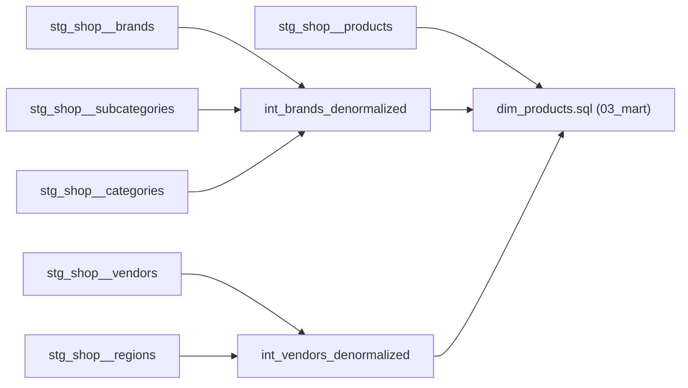

# dbt Layers Conventions

This guide covers the dbt DAG layers used in this project — `01_staging`, `02_intermediate`, and `03_mart` — what each layer may contain, how it must be materialized, and which layers it may `ref()`. It follows [dbt Labs' How We Structure Our dbt Projects](https://docs.getdbt.com/best-practices/how-we-structure/1-guide-overview?version=2.0), adapted to this project's folder names. For schemas, PII, contracts and tests, see [Architecture](architecture.md) §4–§6 and §10. For naming rules (file/column/prefix conventions), see [DW Naming Conventions](dw-naming-conventions.md). For dimension/fact table design, see [Dimensional Modeling Standards](dimensional-modeling-standards.md).

## Table of Contents

1. [Layer Overview](#1-layer-overview)
2. [Staging Layer Rules (01_staging)](#2-staging-layer-rules-01_staging)
3. [Intermediate Layer Rules (02_intermediate)](#3-intermediate-layer-rules-02_intermediate)
4. [Mart Layer Rules (03_mart)](#4-mart-layer-rules-03_mart)
5. [Dependency Direction (ref() rules)](#5-dependency-direction-ref-rules)

---

## 1. Layer Overview

Every model belongs to exactly one layer. Data moves in one direction — source-conformed (shaped by the source system) to business-conformed (shaped by our definitions) — never backward.

| Layer | Folder | Purpose | Default materialization | Prod schema |
|---|---|---|---|---|
| Staging | `01_staging` | One model per source table; light cleanup and PII hashing only | View | `staging` |
| Intermediate | `02_intermediate` | Joins, re-graining, and complex logic between staging and marts | Ephemeral | `intermediate` (only models overridden to view/table) |
| Mart | `03_mart` | Wide, business-defined entities (facts/dimensions) for consumption | Table | `mart_<domain>` |

## 2. Staging Layer Rules (01_staging)

### 2.1 Staging structural constraints
Build exactly one view per source table, and never join nor aggregate.

- **One model per source table** — every source table gets exactly one staging model, using `source()` exclusively. See [DW Naming Conventions, Staging naming](dw-naming-conventions.md#33-staging-naming) for folder-by-source and file naming.
- **View materialization** — always a view, never a table or incremental model except clear intention.
- **No joins** — staging models must not join other models.
- **No aggregations** — grain must stay identical to the source table; aggregating changes grain and belongs downstream.
- **Tests** — `unique` + `not_null` on the primary key of every staging model ([Architecture §10](architecture.md#10-data-quality-and-docs)).

See [dbt Labs: How we structure - Staging](https://docs.getdbt.com/best-practices/how-we-structure/2-staging?version=2.0) for full rationale.

### 2.2 Compulsory cleanup transformations
Every staging model must remove invalid rows, rename to business language, cast to the correct type, and hash PII — before anything downstream sees the data.

#### Definition
Staging-only transformations that turn a raw source table into a clean, business-readable, correctly-typed, PII-free table with no rows removed except invalid/deleted ones.

#### Pros
- Renaming early means every downstream model's SQL reads business-meaningful column names instead of re-translating source jargon in every join
- Casting early means every downstream model can trust column types instead of repeating the same cast
- Filtering invalid/deleted rows once means downstream models never need to repeat that filter

#### Cons
- Adds a fixed cleanup step even for source tables that are already well-named and well-typed
- Renaming decisions made this early are hard to walk back once dozens of downstream models `ref()` the new names

#### Decision
Every staging model must, at minimum: filter out invalid/deleted rows, rename every column to business language (see [DW Naming Conventions](dw-naming-conventions.md)), cast every column to its correct type, and replace every email, phone, name and address with `hash_pii` ([Architecture §6](architecture.md#6-pii)). Structure as sequential CTEs: `source` → `filtered` → `renamed` → `casted` → `hashed` (only when the table has PII).

```sql
-- Yes:
with

source as (
    select * from {{ source('wordpress', 'wp_posts') }}
),

filtered as (
    select * from source
    where post_type = 'courses'
      and post_status <> 'trash'
),

renamed as (
    select
        id as course_id,
        post_title as course_title,
        post_date_gmt as published_at
    from filtered
),

casted as (
    select
        cast(course_id as bigint) as course_id,
        course_title,
        cast(published_at as timestamp) as published_at
    from renamed
)
```

```sql
-- Yes: hashed — the PII column keeps its business name plus a _hash suffix
-- stg_wordpress__users.sql
hashed as (
    select
        user_id,
        {{ hash_pii('user_email') }} as user_email_hash,
        registered_at
    from casted
)
```

### 2.3 Value-level transformations
Apply dimensional modeling's value-level rules at the staging layer, not later — don't restate them here, follow the links.

Continue the CTE chain from the last CTE of 2.2, one CTE per transformation type, in this order:

- **Textual attributes and categorization** — CTE `decoded`:
  - Decode flags/indicators to readable text per [Flags and Indicators as Textual Attributes](dimensional-modeling-standards.md#14-flags-and-indicators-as-textual-attributes).
  - Resolve embedded-meaning attributes per [Attributes with Embedded Meaning](dimensional-modeling-standards.md#15-attributes-with-embedded-meaning).
  - Simple `case when` categorization.
- **Null handling** — CTE `null_handled` — replace nulls with sentinel/default values per [Null Attributes in Dimensions](dimensional-modeling-standards.md#16-null-attributes-in-dimensions) / [Null Foreign Keys in Fact Tables](dimensional-modeling-standards.md#24-null-foreign-keys-in-fact-tables).
- **Derived facts** — CTE `derived` — calculate derived additive facts per [Derived additive facts](dimensional-modeling-standards.md#22-derived-additive-facts).

Postgres has no `select * replace (...)` or `select * except (...)`: list the columns in each CTE.

```sql
-- Yes:
-- stg_crm__customers.sql
decoded as (
    select
        customer_id,
        case gender_code                         -- flags/indicators as text
            when 'M' then 'Male'
            when 'F' then 'Female'
            else 'Unknown'
        end as gender,
        case                                     -- case when categorization
            when age < 18 then 'Under 18'
            when age between 18 and 34 then '18-34'
            when age between 35 and 54 then '35-54'
            else '55+'
        end as age_group,
        membership_tier
    from casted
),

null_handled as (
    select
        customer_id,
        gender,
        age_group,
        coalesce(membership_tier, 'Unknown') as membership_tier
    from decoded
)
```

```sql
-- Yes:
-- stg_shop__sales_lines.sql
derived as (
    select
        *,
        gross_amount - discount_amount as net_amount   -- derived additive fact
    from casted
)
```

## 3. Intermediate Layer Rules (02_intermediate)

### 3.1 Intermediate structural constraints
Build the join/transform layer here — ephemeral by default, chainable, and never exposed to BI.

- **Ephemeral materialization** — ephemeral by default. Override to view or table only when justified, e.g. many models reuse it or it is slow to recompute. An overridden model lands in the `intermediate` schema.
- **Folder grouping** — subfolders by business domain, the same domains as the marts (e.g. `02_intermediate/sales/`).
- **Not exposed to BI/dashboards** — intermediate models are internal plumbing, not a consumption endpoint. `reporter_public` has no grant on `intermediate`.
- **Chaining allowed** — an intermediate model may `ref()` other intermediate models to build a transformation in steps.

See [dbt Labs: Intermediate](https://docs.getdbt.com/best-practices/how-we-structure/3-intermediate?version=2.0) for full rationale.

### 3.2 Typical intermediate transformations
Use the intermediate layer for joins, re-graining, and business-rule transformations that would clutter a mart model.

- **Insert unknown/default dimension rows** — `int_<entity>_inserted_unknown` — union the "UNKNOWN" row per [Null foreign keys](dimensional-modeling-standards.md#12-null-foreign-keys).

```sql
-- Yes: inserted_unknown
-- int_products_inserted_unknown.sql
products as (
    select * from {{ ref('stg_shop__products') }}
),

unknown_product as (
    select
        'UNKNOWN' as product_id,
        'Unknown' as product_name
),

inserted_unknown as (
    select * from products
    union all
    select * from unknown_product
)
```

- **Denormalize dimensions closer to mart shape** — `int_<entity>_denormalized`, one model per hierarchy — only when a mart dimension will consume the flattened hierarchy as columns. Don't pre-flatten a hierarchy that no mart dimension needs. Per [Denormalized Flattened Dimensions](dimensional-modeling-standards.md#13-denormalized-flattened-dimensions).



```sql
-- Yes: denormalized
-- int_brands_denormalized.sql
denormalized as (
    select
        b.brand_id,
        b.brand_name,
        sc.subcategory_name,
        c.category_name
    from {{ ref('stg_shop__brands') }} b
    left join {{ ref('stg_shop__subcategories') }} sc on b.subcategory_id = sc.subcategory_id
    left join {{ ref('stg_shop__categories') }} c on sc.category_id = c.category_id
)
-- later we will denormalize this into dim_products, see 4.2 for example
```

- **Header/line join and allocation** — `int_<entity>_joined_to_header` — bring header-level foreign keys and degenerate dimensions down onto the line grain, and allocate header-level measures (e.g. an order-level discount) across lines to avoid double-counting, per [Header/Line Fact Tables](dimensional-modeling-standards.md#21-headerline-fact-tables).

```sql
-- Yes: joined_to_header, allocated
-- int_order_lines_joined_to_header.sql
joined_to_header as (
    select
        h.order_no,
        h.order_date,
        h.customer_id,
        h.order_discount,
        l.line_no,
        l.product_id,
        l.line_amount,
        sum(l.line_amount) over (partition by h.order_no) as order_line_amount_total
    from {{ ref('stg_shop__order_headers') }} h
    join {{ ref('stg_shop__order_lines') }} l on h.order_no = l.order_no
),

allocated as (
    select
        order_no,
        order_date,
        customer_id,
        line_no,
        product_id,
        line_amount,
        order_discount * (line_amount / order_line_amount_total) as allocated_discount   -- avoids double-counting
    from joined_to_header
)
```

- **Other dbt-recommended transformations** — joining staging models together, re-graining (fanning out or collapsing to a new grain), isolating complex/hard-to-read logic into its own step. See [dbt Labs: Intermediate](https://docs.getdbt.com/best-practices/how-we-structure/3-intermediate?version=2.0).


## 4. Mart Layer Rules (03_mart)

### 4.1 Mart structural constraints
Materialize as table or incremental, grouped into subfolders by business domain, one dim/fact per file at entity grain.

- **Materialization** — table for dimensions; transaction facts are `incremental` with `incremental_strategy: delete+insert` and a `unique_key` ([Architecture §5](architecture.md#materializations)); view for [role playing dimensions](dimensional-modeling-standards.md#17-role-playing-dimension), since a role-playing dimension is a thin wrapper aliasing the base dimension, not a table of its own.
- **Folder grouping** — subfolders by business domain (e.g. `03_mart/sales`, `03_mart/metabase`). Each domain builds into its own prod schema `mart_<domain>`, so grants to the public Metabase can be set per domain.
- **Contracts** — `contract: {enforced: true}` on every mart model, with every column and type declared ([Architecture §10](architecture.md#10-data-quality-and-docs)).
- **Entity grain** — one model per dimension or fact table; a model must not mix grains.
- **No PII** — mart columns never hold raw PII; `assert_no_pii_in_marts` fails the build otherwise ([Architecture §6](architecture.md#6-pii)).

### 4.2 Apply dimensional modeling standards
The full [Dimensional Modeling Standards](dimensional-modeling-standards.md) doc governs mart-layer table design — don't restate it here, follow the links.

Most directly relevant to mart construction:

- **Denormalized dimensions** — a mart dimension is where a flattened hierarchy from the intermediate layer lands as columns, per [Denormalized Flattened Dimensions](dimensional-modeling-standards.md#13-denormalized-flattened-dimensions).

```sql
-- Yes: dim_products.sql — joins each flattened hierarchy onto the product grain
select
    p.product_id,
    p.product_name,
    brands.brand_name,
    brands.category_name,
    vendors.vendor_name,
    vendors.region_name
from {{ ref('stg_shop__products') }} p
left join {{ ref('int_brands_denormalized') }} brands on p.brand_id = brands.brand_id
left join {{ ref('int_vendors_denormalized') }} vendors on p.vendor_id = vendors.vendor_id
```

- **Role playing dimensions** — a mart may expose the same base dimension multiple times under different roles (e.g. `dim_order_date`, `dim_ship_date` from one date dimension), per [Role playing dimension](dimensional-modeling-standards.md#17-role-playing-dimension).

```sql
-- Yes: dim_ship_date.sql — thin role view over the base date dimension
select
    {{ dbt_utils.star(from=ref('dim_date'), prefix="ship_") }}
from {{ ref('dim_date') }}
```

- **Slowly Changing Dimensions (SCD)** — a mart dimension tracks attribute history as Type 6 (Type 2 row + Type 3 column maintained via Type 1 overwrite), per [Slowly Changing Dimensions (SCD)](dimensional-modeling-standards.md#31-slowly-changing-dimensions-scd).


## 5. Dependency Direction (ref() rules)

### 5.1 One-directional layering
Data flows `01_staging` → `02_intermediate` → `03_mart`, never backward.

- **No backward refs** — a staging model must never `ref()` an intermediate or mart model. An intermediate model must never `ref()` a mart model.
- **Same-layer refs** — intermediate models may `ref()` other intermediate models (see [3.1](#31-intermediate-structural-constraints)); mart models may `ref()` other mart models (dim/fact cross-refs, role-playing views).

See [dbt Labs: How we structure](https://docs.getdbt.com/best-practices/how-we-structure/1-guide-overview?version=2.0) for the overall DAG shape ("narrow the DAG, widen the tables").

### 5.2 Skipping intermediate is conditional, not forbidden
A mart model may `ref()` a staging model directly only when no join, re-grain, or complex logic is needed — otherwise build the intermediate step first.

#### Definition
Whether a mart model may reference a staging model directly, bypassing `02_intermediate` entirely.

#### Pros
- Fewer models for genuinely simple dimensions/facts — a 1:1 staging table needing only what staging already did doesn't need a pass-through intermediate model just for the sake of layering
- Shorter DAG for simple cases means less to navigate when tracing lineage

#### Cons
- Easy to rationalize "just one join" directly in a mart model, and the mart layer accumulates undocumented join/business logic that's hard to test or reuse
- Once a mart model mixes staging refs and business logic, refactoring it into an intermediate model later touches every downstream consumer

#### Decision
A mart model may `ref()` a staging model directly only when none of [3.1](#31-intermediate-structural-constraints)'s or [3.2](#32-typical-intermediate-transformations)'s triggers apply — no join, no re-grain, no complex logic to isolate. The moment a mart model needs to join two or more staging models, or apply non-trivial business logic, that logic belongs in an intermediate model first.

```sql
-- Yes: dim_coupons.sql — one staging table, no joins, no re-grain
select * from {{ ref('stg_wordpress__coupons') }}
```

```sql
-- No: fact_order_items.sql — joining two staging models directly in a mart
select
    i.order_item_id,
    o.order_date,
    o.customer_id,
    i.course_id,
    i.sale_amt
from {{ ref('stg_wordpress__order_items') }} i
join {{ ref('stg_wordpress__orders') }} o on i.order_id = o.order_id
-- should be: int_order_items_joined_to_header.sql in 02_intermediate,
-- with fact_order_items.sql in 03_mart referencing that instead
```
