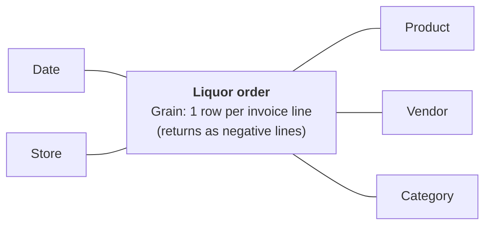

# Liquor order

Sources: [sales_2025, sales_2026](../../profiling/iowa_liquor/sales.md),
[products](../../profiling/iowa_liquor/products.md)

Scope: 2025–2026. Later years (`sales_2012` … `sales_2024`) must fit the same design.

## 1. Business process
Licensed Iowa stores order liquor from the state. The state (ABD) is the wholesaler, so
each sales row is one line of a store's order. Stores return product on the same kind of
invoice (`RINV-`). Why: the rows are wholesale orders at the state retail price
(`sales_dollars` is what the store pays), not sales to shoppers, so "Liquor order" names the
activity better than "liquor sales".

## 2. Grain
One row per invoice line: one item on one store's order from the state, as ABD bills it.
Returns are invoice lines too (`RINV-`, negative quantities) and sit in the same fact.
Why: the line is the atomic event, the finest grain the data has. Every coarser grain
(invoice, store × item × day) sums up from it. Issues that bear on the grain:
[sales #1](../../profiling/iowa_liquor/sales.md#1-invoice_id-is-not-unique-from-2025-09-01)
(no natural line key from 2025-09-01; an invoice can repeat an identical line),
[sales #2](../../profiling/iowa_liquor/sales.md#2-2025-lines-from-2025-10-27-on-are-loaded-twice)
(late 2025 loaded twice) and
[sales #9](../../profiling/iowa_liquor/sales.md#9-returns-are-rinv--lines-with-negative-quantities)
(returns).

## 3. Dimensions
| Dimension | One value per row because | Conformed with |
|---|---|---|
| Date | the line has one order date (`ordered_on`) | Date (bus matrix column; first real Date dimension) |
| Store | the line has one ordering store; location (city, zip, county) is a store attribute ([sales #7](../../profiling/iowa_liquor/sales.md#7-store-attributes-change-over-time-some-locations-missing)) | — |
| Product | the line has one item, never missing | — |
| Vendor | the line has one vendor, the item's vendor at the time of the order; 66 items changed vendor in 2026 | — |
| Category | the line has one category, the item's category at the time of the order ([sales #6](../../profiling/iowa_liquor/sales.md#6-category-names-renamed-an-items-category-changes-over-time)); on Product it would be multivalued ([products #1](../../profiling/iowa_liquor/products.md#1-item_no-is-not-unique)) | — |
| Invoice (degenerate, on the fact) | the line belongs to one invoice, with one type: order (`INV-`) or return (`RINV-`) ([sales #9](../../profiling/iowa_liquor/sales.md#9-returns-are-rinv--lines-with-negative-quantities)) | — |

Why Vendor and Category stand alone, not inside Product: both change per item over time,
the line records the value that applied at the order, and analysts slice by each on its own.

## 4. Facts
| Fact | Additivity | Note |
|---|---|---|
| Bottles ordered | additive | negative on returns ([sales #9](../../profiling/iowa_liquor/sales.md#9-returns-are-rinv--lines-with-negative-quantities)) |
| Order amount | additive | what the store pays the state; [sales #3](../../profiling/iowa_liquor/sales.md#3-money-and-volume-are-whole-numbers-from-2025-11-01-to-2026-01-31), [sales #5](../../profiling/iowa_liquor/sales.md#5-sales_dollars--bottles--retail-on-some-lines) |
| Volume in liters | additive | [sales #3](../../profiling/iowa_liquor/sales.md#3-money-and-volume-are-whole-numbers-from-2025-11-01-to-2026-01-31) |
| State cost amount | additive | derived: bottles × state bottle cost; [sales #4](../../profiling/iowa_liquor/sales.md#4-cost-and-retail-are-null-before-2025-07-01) |
| State bottle cost | non-additive | unit price as billed on the line; [sales #4](../../profiling/iowa_liquor/sales.md#4-cost-and-retail-are-null-before-2025-07-01) |
| State bottle retail | non-additive | unit price as billed on the line; [sales #4](../../profiling/iowa_liquor/sales.md#4-cost-and-retail-are-null-before-2025-07-01) |

Gallons (`sales_gallons`) is dropped: a measure nobody needs. Pack and bottle volume describe
the product as sold ([sales #8](../../profiling/iowa_liquor/sales.md#8-item-description-and-pack-change-over-time)):
they belong to Product, not the fact.

## Bubble chart

## Open questions
- Publisher questions that bear on this design, open in the profiling record:
  [README Q8](../../profiling/iowa_liquor/_README.md#questions-for-the-human) (line key),
  Q9 (doubled late 2025), Q10 (rounded money), Q11 (order amount vs bottles × retail).
