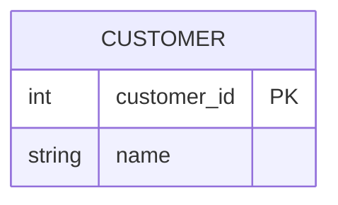
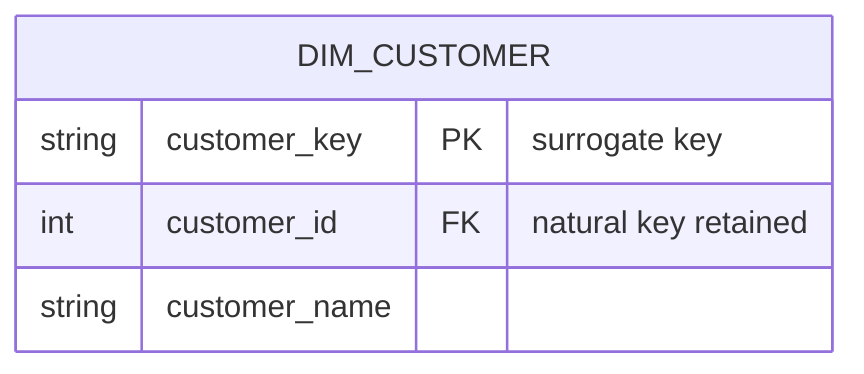
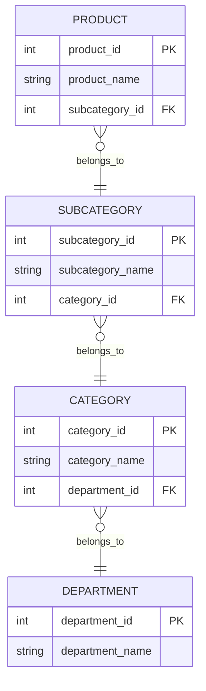
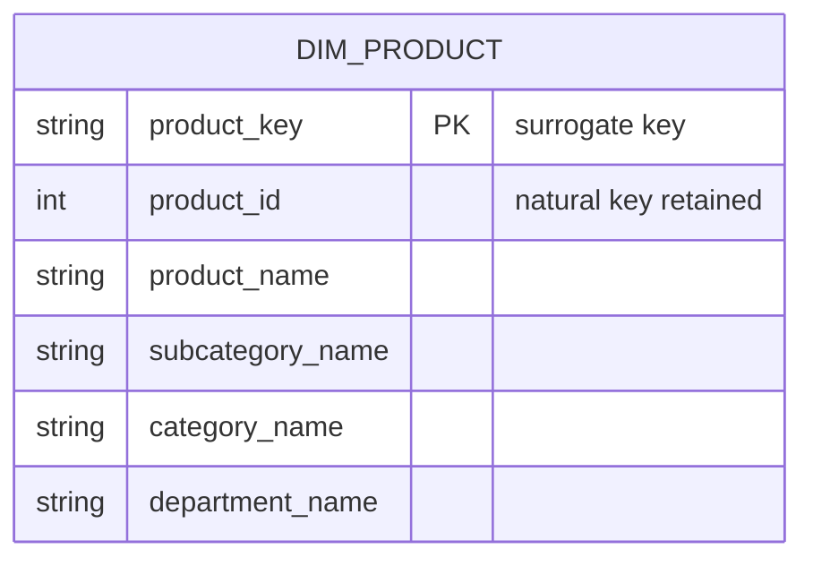
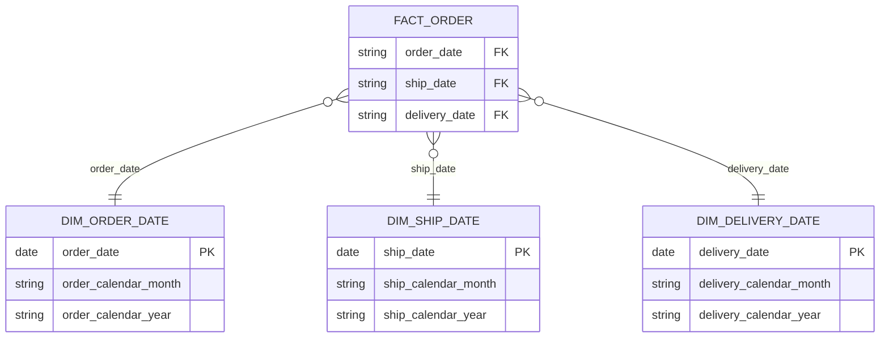
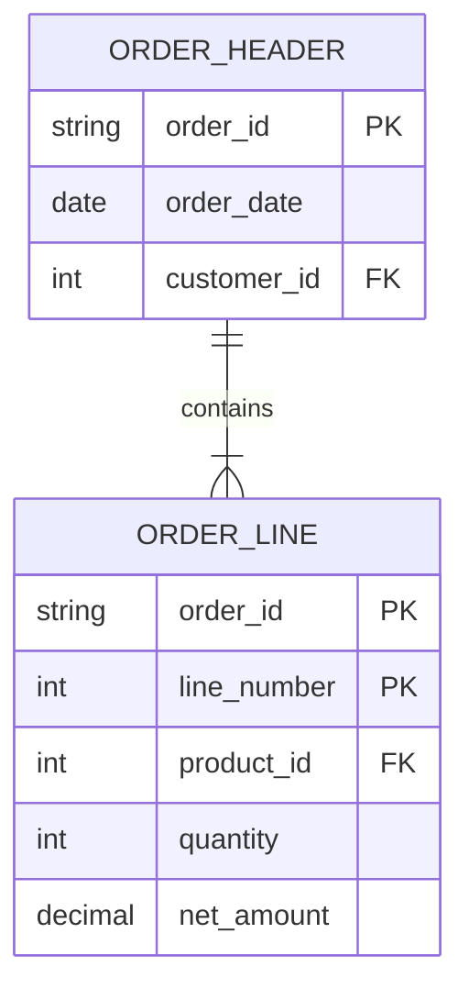
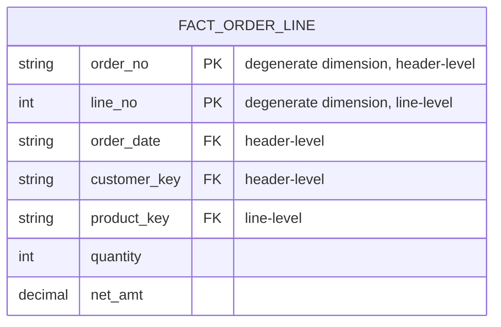

# Dimensional Modeling Standards

Dimensional Modelling is the ultimate data modelling architecture for data warehouses. These standards govern the `03_mart` layer — see [dbt Layers Conventions](dbt-layers-conventions.md) for where each transformation runs, and [DW Naming Conventions](dw-naming-conventions.md) for column names. Examples use a hypothetical `shop` source.

## Table of Contents

1. [Dimension table standards](#1-dimension-table-standards)
   1. [Dimension Surrogate Keys](#11-dimension-surrogate-keys)
   2. [Null foreign keys](#12-null-foreign-keys)
   3. [Denormalized Flattened Dimensions](#13-denormalized-flattened-dimensions)
   4. [Flags and Indicators as Textual Attributes](#14-flags-and-indicators-as-textual-attributes)
   5. [Attributes with Embedded Meaning](#15-attributes-with-embedded-meaning)
   6. [Null Attributes in Dimensions](#16-null-attributes-in-dimensions)
   7. [Role playing dimension](#17-role-playing-dimension)
   8. [Conformed Dimensions](#18-conformed-dimensions)
2. [Fact table standards](#2-fact-table-standards)
   1. [Header/Line Fact Tables](#21-headerline-fact-tables)
   2. [Derived additive facts](#22-derived-additive-facts)
   3. [Null Measures](#23-null-measures)
   4. [Null Foreign Keys in Fact Tables](#24-null-foreign-keys-in-fact-tables)
   5. [Conformed Facts](#25-conformed-facts)
3. [Dimension Advanced Standards](#3-dimension-advanced-standards)
   1. [Slowly Changing Dimensions (SCD)](#31-slowly-changing-dimensions-scd)

---

## 1. Dimension table standards

### 1.1 Dimension Surrogate Keys

Create a surrogate key on every dimension and fact table using `dbt_utils.generate_surrogate_key`.

#### Definition
A surrogate key is a warehouse-managed primary key assigned to every dimension row, independent of the operational source system's natural key.

#### Pros
- Enables multi-source integration — incompatible natural keys from different systems map to one consistent key
- Supports change tracking — multiple dimension rows for the same natural key (different time periods) each receive a unique surrogate key
- DW/BI controls key space — not dependent on source system key quality or administration

#### Cons
- Adds a column compared to using natural keys directly
- Natural key must still be retained on the dimension for source traceability
- Requires a consistent generation strategy across all models

#### Decision
Create a surrogate key on every dimension and fact table. Name it `<entity>_key` in snake_case — see [Data Warehouse Naming Conventions, Key column suffixes](dw-naming-conventions.md#41-key-column-suffixes). Generate it with `dbt_utils.generate_surrogate_key` over the natural key columns.

Exception: the date dimension is a special case — key it by the date value itself, not a generated hash, since a date is already unique, stable, and meaningful without hashing.

**Operational**


| customer_id | name |
|---|---|
| 101 | Acme Corp |
| 102 | Globex Inc |

**Dimensional**


| customer_key | customer_id | customer_name |
|---|---|---|
| 9f8a2b1c | 101 | Acme Corp |
| 3d7e5f0a | 102 | Globex Inc |

```sql
-- Yes:
select
    {{ dbt_utils.generate_surrogate_key(['customer_id']) }} as customer_key,
    customer_id,
    ...
```

```sql
-- Yes:
select
    {{ dbt_utils.generate_surrogate_key(['customer_id', 'source_system']) }} as customer_key,
    customer_id,
    source_system,
    ...
```

```sql
-- No:
select
    customer_id as customer_key,                              -- natural key used as PK
    row_number() over (order by customer_id) as customer_key  -- sequence: not idempotent
    ...
```

### 1.2 Null foreign keys

Never leave a fact table foreign key null; every dimension must ship a default "UNKNOWN" row for it to point to instead.

#### Definition
Dimension tables must include a default row — representing "no dimension attached" / unknown / not-applicable — with its own surrogate key. A fact table foreign key must never be null; referential integrity is violated if a fact row's FK doesn't resolve to any dimension row, and null keys confuse users because they can't be joined or filtered on cleanly.

#### Pros
- Referential integrity holds — every fact FK resolves to an existing dimension row
- Users filter/join/group on the default member like any other row instead of special-casing null
- Inner joins between fact and dimension don't silently drop rows that lack a real dimension value

#### Cons
- Every dimension needs an extra unioned row, kept in sync with the real-row key generation strategy

#### Decision
Every dimension must ship a default row for the "no dimension attached" case. Give it the natural key `-1` (or `'UNKNOWN'` when the natural key is text) and `'Unknown'` in every text attribute (see [Null Attributes in Dimensions](#16-null-attributes-in-dimensions)). Source ids are auto-increment from 1, so `-1` never collides with a real row. Generate its surrogate key from that natural key exactly like every real row, so the unknown key is always `generate_surrogate_key` over `-1`. Add the row in the intermediate model at the dimension's grain — see [dbt Layers Conventions, Typical intermediate transformations](dbt-layers-conventions.md#32-typical-intermediate-transformations) — and generate the key in the dimension. Never leave a fact table foreign key null; point it at the default row's key instead. See [Null Foreign Keys in Fact Tables](#24-null-foreign-keys-in-fact-tables) for the fact-table side of this rule.

```sql
-- Yes: int_customer_inserted_unknown.sql
with

customer as (
    select
        customer_id,
        customer_name
    from {{ ref('stg_shop__customer') }}
),

unknown_customer as (
    select
        -1 as customer_id,
        'Unknown' as customer_name
),

inserted_unknown as (
    select * from customer
    union all
    select * from unknown_customer
)

select * from inserted_unknown
```

```sql
-- Yes: dim_customer.sql — one key formula for every row, unknown included
select
    {{ dbt_utils.generate_surrogate_key(['customer_id']) }} as customer_key,
    customer_id,
    customer_name
from {{ ref('int_customer_inserted_unknown') }}
```

### 1.3 Denormalized Flattened Dimensions

Flatten known, fixed-depth hierarchies into attributes on the dimension row instead of normalizing into separate tables.

#### Definition
A denormalized flattened dimension collapses a many-to-one, fixed-depth hierarchy (e.g., product → subcategory → category → department) into separate attribute columns on a single dimension row, rather than normalizing each hierarchy level into its own table (snowflaking).

#### Pros
- Fewer joins — one dimension table instead of a chain of hierarchy tables
- Query performance improves — BI tools and users filter/group directly on flat columns
- Simpler for business users to browse than a snowflaked schema

#### Cons
- Redundant storage — higher-level attribute values repeat across every row that shares them

#### Decision
Flatten known, fixed-depth hierarchies into attributes on the dimension row instead of normalizing into separate tables.

**Operational**


**Dimensional**


| product_key | product_id | product_name | subcategory_name | category_name | department_name |
|---|---|---|---|---|---|
| 7c1a44de | 501 | Trail Runner 900 | Running Shoes | Footwear | Sporting Goods |
| 2b6f91aa | 502 | Trail Runner 700 | Running Shoes | Footwear | Sporting Goods |
| 9d2e6b31 | 503 | Court Sprint Low | Court Shoes | Footwear | Sporting Goods |
| e14f88c2 | 504 | Court Sprint High | Court Shoes | Footwear | Sporting Goods |
| 5a3c70d9 | 505 | Yoga Mat Pro | Fitness Equipment | Fitness | Sporting Goods |
| c082f1e6 | 506 | Yoga Block Duo | Fitness Equipment | Fitness | Sporting Goods |

### 1.4 Flags and Indicators as Textual Attributes

Replace cryptic flags and codes with descriptive text attributes.

#### Definition
Cryptic abbreviations (Y/N, 1/0), true/false flags, and low-cardinality codes carry meaning that isn't visible without a lookup table. A textual attribute replaces the code with a self-describing word.

#### Pros
- Self-describing values — users read reports without a code-to-meaning lookup
- Filters and group-bys read naturally (`holiday_indicator = 'Holiday'` instead of `is_holiday_flag = 'Y'`)

#### Cons
- Extra transformation logic maps codes to text, and must stay in sync if source codes change

#### Decision
Replace cryptic flags and codes with descriptive text attributes. Retain the original code as a reference column when source traceability is needed. Name the resulting column per [Data Warehouse Naming Conventions, Boolean and indicator columns](dw-naming-conventions.md#45-boolean-and-indicator-columns) — `is_`/`has_` prefix or `_indicator` suffix.

```sql
-- Yes:
    case is_holiday_flag
        when 'Y' then 'Holiday'
        else 'Non-holiday'
    end as holiday_indicator
```

Report grouped on raw flag (cryptic) — `group by is_holiday_flag`

| is_holiday_flag | revenue_amt |
|---|---|
| Y | 15000.00 |
| N | 42000.00 |

Report grouped on textual indicator (self-describing) — `group by holiday_indicator`

| holiday_indicator | revenue_amt |
|---|---|
| Holiday | 15000.00 |
| Non-holiday | 42000.00 |

```sql
-- Yes:
    case order_status_code
        when 'P' then 'Pending'
        when 'S' then 'Shipped'
        when 'D' then 'Delivered'
        when 'C' then 'Cancelled'
        when 'R' then 'Returned'
    end as order_status
```

```sql
-- No: cryptic flag and low-cardinality code left unexpanded
select
    is_holiday_flag,     -- Y/N, meaningless without a lookup table
    order_status_code    -- P/S/D/C/R, meaningless without a lookup table
```

### 1.5 Attributes with Embedded Meaning

Decompose multipart codes into one attribute per embedded component, alongside the original.

#### Definition
Operational codes — often natural keys — can pack multiple characteristics into one string, with different character ranges representing distinct attributes (e.g., manufacturer, product line, SKU).

#### Pros
- Decomposed codes expose each embedded component as its own filterable/groupable column
- Retaining the full code preserves source traceability and keeps the natural key usable for lookups

#### Cons
- Decomposition logic is brittle — a change in the source code's character layout silently breaks every derived attribute

#### Decision
Preserve the multipart code in its entirety, and additionally break it into one attribute per component. 

For example, a VIN's first three characters (the WMI) identify the manufacturer, so add a `manufacturer_name` attribute alongside the full VIN.

```sql
-- Yes:
    vin,
    case left(vin, 3)
        when '1HG' then 'Honda'
        when '5YJ' then 'Tesla'
        when '1FT' then 'Ford'
    end as manufacturer_name,           -- WMI decoded against the WMI registry
```

| vin | manufacturer_name |
|---|---|
| 1HGCM82633A004352 | Honda |
| 5YJSA1E26HF000337 | Tesla |
| 1HGCM66531A123456 | Honda |
| 1HGBH41JXMN109186 | Honda |
| 5YJ3E1EA8JF000123 | Tesla |
| 1FTFW1ET5BFC10312 | Ford |


### 1.6 Null Attributes in Dimensions

Replace null, empty value with `'Unknown'`.

#### Definition
Null-valued dimension attributes occur when a dimension row hasn't been fully populated, or when an attribute doesn't apply to every row.

#### Pros
- Grouping/filtering behaves consistently — databases handle null grouping inconsistently, a literal string doesn't
- Reports show a value in every cell instead of a blank, so users aren't left guessing whether the field is broken or genuinely empty
- BI tools filter/group on the placeholder like any other value

#### Cons
- Placeholder string can collide with a real attribute value if not chosen carefully
- Every nullable attribute needs coalescing at transform time instead of being left to the query layer

#### Decision
Replace null, empty string `''` or equivalent empty-value `NA` `N/A` with `'Unknown'` at transform time using `coalesce`.

```sql
-- Yes:
select
    customer_id,
    coalesce(customer_segment, 'Unknown') as customer_segment,
    coalesce(nullif(trim(customer_region), ''), nullif(customer_region, 'NA'), 'Unknown') as customer_region
from {{ source('shop', 'customers') }}
```

Before (`source('shop', 'customers')`)

| customer_id | customer_segment | customer_region |
|---|---|---|
| 201 | `null` | `''` |
| 202 | Enterprise | NA |
| 203 | SMB | APAC |
| 204 | `null` | `'   '` |
| 205 | Startup | `null` |

After (null handling applied)

| customer_id | customer_segment | customer_region |
|---|---|---|
| 201 | Unknown | Unknown |
| 202 | Enterprise | Unknown |
| 203 | SMB | APAC |
| 204 | Unknown | Unknown |
| 205 | Startup | Unknown |

### 1.7 Role playing dimension

Build the dimension physically once; give each fact-table reference its own role-named view with role-prefixed column names.

#### Definition
A single physical dimension can be referenced multiple times in a fact table, each reference representing a logically distinct role. A fact table with several dates, for example, holds a separate foreign key per date role (order date, ship date, delivery date), each pointing at the same underlying date dimension. Each foreign key must resolve to an independent view of that dimension — with role-specific column names — so the references don't collide.

#### Pros
- Single source of truth — the physical dimension is built and maintained once; each role is a thin view, not a duplicated table
- Attribute names don't collide when the same dimension is joined multiple times in one query (`order_date`, `ship_date` vs. two columns both named `date`)
- BI tools and analysts treat each role as its own named dimension, so joins stay unambiguous without table-aliasing gymnastics

#### Cons
- Extra model per role — a date dimension used three ways needs three thin wrapper models
- Column aliases must be kept in sync if the base dimension's schema changes

#### Decision
Build one physical dimension. For each role a fact table needs, create a dedicated view model that selects from the base dimension and prefixes every column (including the key) with the role name. Name the fact table's foreign key after the role, not the base dimension — see [Data Warehouse Naming Conventions, Role-playing foreign key naming](dw-naming-conventions.md#42-role-playing-foreign-key-naming).

**Dimensional**


```sql
-- Yes: dim_ship_date.sql — thin role view over the base date dimension
select
    date as ship_date,
    calendar_month as ship_calendar_month,
    calendar_year as ship_calendar_year
from {{ ref('dim_date') }}
```

```sql
-- Yes: dim_ship_date.sql — dbt_utils.star prefixes every column, no manual aliasing
select
    {{ dbt_utils.star(from=ref('dim_date'), prefix="ship_") }}
from {{ ref('dim_date') }}
```

```sql
-- No: base dimension joined 3x with unprefixed columns — attribute names collide
select
    o.order_id,
    d1.calendar_year as order_calendar_year,
    d2.calendar_year,   -- ambiguous: also "calendar_year", caller must alias every column
    d3.calendar_year
from {{ ref('fact_order') }} o
left join {{ ref('dim_date') }} d1 on o.order_date = d1.date
left join {{ ref('dim_date') }} d2 on o.ship_date = d2.date
left join {{ ref('dim_date') }} d3 on o.delivery_date = d3.date
```

### 1.8 Conformed Dimensions

Agree on identical keys, column names, definitions, and values for a dimension across every team and fact table that uses it — mismatched labels or casing break drill-across reporting even when the underlying data is otherwise correct.

#### Definition
Conformed dimensions share identical column names and identical domain contents across every fact table that references them.

At the most basic level, conformed dimensions mean the same thing with every possible fact table to which they are joined. The date dimension table connected to the sales facts is identical to the date dimension table connected to the inventory facts. Identical conformed dimensions have consistent dimension keys, attribute column names, attribute definitions, and attribute values (which translate into consistent report labels and groupings). Dimension attributes don’t conform if they’re called Month in one dimension and Month Name in another; likewise, they don’t conform if the attribute value is “July” in one dimension and “JULY” in another.

#### Pros
- Drill-across reports work — grouping columns match in name, definition, and value formatting across every fact table, so rows from separate fact tables align correctly
- Analytic consistency — "July" means the same calendar month, spelled the same way, everywhere in the warehouse, instead of each team inventing its own label or casing
- Reduced development cost — a conformed dimension (or a certified subset/role-playing view of it) is built once, to one governed standard, and reused instead of re-created per fact table

#### Cons
- Requires upfront cross-team governance — agreeing on key names, attribute names, definitions, and value formats is a governance exercise, not just a modeling one
- Silent breakage risk — a team that builds a dimension without checking the standard can produce "JULY" instead of "July"; nothing errors, but drill-across quietly stops aligning

#### Decision
Conform every dimension to one governed standard: identical surrogate keys where the grain matches, identical attribute column names, identical attribute definitions, and identical value formatting. This applies whether a fact table joins the same physical dimension table or a certified subset/role-playing view of it (see [Role playing dimension](#17-role-playing-dimension)) — the requirement is consistency of names, definitions, and values, not necessarily one shared table. Never let two dimensions serving the same business concept diverge in column naming, attribute definition, or value casing — see [Data Warehouse Naming Conventions, Consistency across models](dw-naming-conventions.md#15-consistency-across-models).

```sql
-- Yes: fact_sales and fact_inventory both group by calendar_month, both return 'July'
select calendar_month, sum(sales_amt) as sales_amt
from {{ ref('fact_sales') }} s
join {{ ref('dim_date') }} d on s.order_date = d.date
group by calendar_month

select calendar_month, sum(inventory_qty) as inventory_qty
from {{ ref('fact_inventory') }} i
join {{ ref('dim_date') }} d on i.transaction_date = d.date
group by calendar_month
-- results from both queries align in a drill-across report on calendar_month
```


## 2. Fact table standards

### 2.1 Header/Line Fact Tables

Roll every header-level foreign key and degenerate dimension down onto the line-level fact table; never ship a separate header-grain fact.

#### Definition
Operational transaction systems often split a transaction into a header row (one per transaction) and multiple line rows (one per line item), also known as a parent/child schema. A header/line fact table carries all header-level dimension foreign keys and degenerate dimensions on the line-grain fact, so the line fact table stands alone at its natural grain.

#### Pros
- One fact table at the true grain — no join back to a separate header fact needed to filter or report by header-level attributes (customer, order date, salesperson)
- Header-only metrics still work — count distinct on the header degenerate dimension (`order_no`), or aggregate line measures up
- Avoids a fan-out/mixed-grain join between two fact tables that BI tools and analysts would otherwise have to reconcile

#### Cons
- Header-level facts (e.g., an order-level discount or shipping charge) must be allocated across lines to avoid double-counting when summed
- Counting transactions requires `count(distinct order_no)`, not a plain row count, since row count reflects line volume

#### Decision
Never build a separate header-grain fact table for a header/line source. Include every header-level dimension foreign key and header degenerate dimension (e.g., `order_no`, `order_date`, `customer_key`) directly on the line-level fact table, at line grain — see [Data Warehouse Naming Conventions, Degenerate dimension suffix](dw-naming-conventions.md#43-degenerate-dimension-suffix) for how to name a degenerate dimension column.

**Operational**


ORDER_HEADER

| order_id | order_date | customer_id |
|---|---|---|
| ORD-1001 | 2026-06-01 | 101 |
| ORD-1002 | 2026-06-03 | 102 |

ORDER_LINE

| order_id | line_number | product_id | quantity | net_amount |
|---|---|---|---|---|
| ORD-1001 | 1 | 501 | 2 | 199.98 |
| ORD-1001 | 2 | 504 | 1 | 49.99 |
| ORD-1001 | 3 | 503 | 1 | 89.99 |
| ORD-1002 | 1 | 505 | 3 | 44.97 |
| ORD-1002 | 2 | 506 | 1 | 24.99 |

**Dimensional**


| order_no | line_no | order_date | customer_key | product_key | quantity | net_amt |
|---|---|---|---|---|---|---|
| ORD-1001 | 1 | 2026-06-01 | 9f8a2b1c | 7c1a44de | 2 | 199.98 |
| ORD-1001 | 2 | 2026-06-01 | 9f8a2b1c | e14f88c2 | 1 | 49.99 |
| ORD-1001 | 3 | 2026-06-01 | 9f8a2b1c | 9d2e6b31 | 1 | 89.99 |
| ORD-1002 | 1 | 2026-06-03 | 3d7e5f0a | 5a3c70d9 | 3 | 44.97 |
| ORD-1002 | 2 | 2026-06-03 | 3d7e5f0a | c082f1e6 | 1 | 24.99 |

```sql
-- Yes: fact_order_line.sql — header-level keys rolled down onto the line grain
select
    o.order_no,             -- PK, degenerate dimension, header-level
    l.line_no,              -- PK, degenerate dimension, line-level
    o.order_date,           -- header-level FK
    o.customer_key,         -- header-level FK
    l.product_key,          -- line-level FK
    l.quantity,
    l.net_amt
from {{ ref('stg_shop__order_header') }} o
join {{ ref('stg_shop__order_line') }} l on o.order_no = l.order_no
```


### 2.2 Derived additive facts

Compute derived additive facts once at load time and store them as physical columns; don't leave the calculation to query time.

#### Definition
A derived fact is a measure calculated from other facts on the same row (e.g., `gross_amt = quantity * unit_price`, `gross_profit = revenue_amt - cost_amt`). When the derived fact is itself additive — it can be correctly summed across any dimension — it's a derived additive fact.

#### Pros
- Computed once, consistently — every user, report, and BI tool reads the same value instead of re-deriving it with (potentially divergent) logic
- Simpler downstream SQL and BI semantic layers — no formula to repeat or get subtly wrong in every query
- Query performance improves — no repeated computation per query, per tool

#### Cons
- Extra storage for a column that's technically redundant with its inputs
- The load process must recompute the derived fact if any of its inputs are corrected

#### Decision
Store every derived additive fact as a physical column in the fact table, computed once during the load. Never rely on a downstream query, report, or BI tool to derive it — the storage cost is minor compared to the cost of a user or tool computing it inconsistently.

```sql
-- Yes: gross_amt computed once, physically stored on fact_order_line
select
    order_no,
    line_no,
    product_key,
    quantity,
    unit_price,
    quantity * unit_price as gross_amt   -- derived additive fact, stored
from {{ ref('stg_shop__order_line') }}
```

```sql
-- No: gross_amt left for every consumer to derive themselves
select
    order_no,
    line_no,
    product_key,
    quantity,
    unit_price
    -- every report/BI tool must remember to multiply quantity * unit_price,
    -- and risks getting it wrong (e.g. forgetting a discount factor)
from {{ ref('stg_shop__order_line') }}
```

### 2.3 Null Measures

Leave a fact table measure null when it genuinely doesn't apply; never coalesce it to `0`.

#### Definition
A null measure is a fact table measurement column with no value because the measurement doesn't apply to that row (e.g., `shipping_cost_amt` before an order has shipped). `sum`, `count`, `min`, `max`, and `avg` all already skip null measures correctly, treating "not applicable" differently from zero.

#### Pros
- Preserves the distinction between "not applicable" and "zero" — `avg` in particular gives a wrong answer if a not-applicable measure is coalesced to `0` instead of left null
- Standard aggregate functions already handle null measures correctly, with no extra transform logic needed

#### Cons
- Downstream consumers must know the difference between a null measure and a zero measure, or risk miscounting (e.g. `count(measure)` vs `count(*)`)

#### Decision
Leave a fact table measure null when the measurement genuinely doesn't apply to that row. Never coalesce it to `0`, which would corrupt `avg` and other non-`sum` aggregates.

```sql
-- Yes: shipping_cost_amt left null — not yet shipped, not zero cost
select
    order_no,
    line_no,
    shipping_cost_amt   -- null: not yet shipped, not zero cost
from {{ ref('stg_shop__order_line') }}
```

```sql
-- No: shipping_cost_amt coalesced to 0 — corrupts avg(shipping_cost_amt) across shipped and unshipped lines
select
    order_id as order_no,
    line_number as line_no,
    coalesce(shipping_cost_amt, 0)   -- treats "not yet shipped" as "shipped for free"
from {{ ref('stg_shop__order_line') }}
```

### 2.4 Null Foreign Keys in Fact Tables

Never leave a fact table foreign key null; point it at the dimension's default row instead.

#### Definition
A null foreign key is a fact table dimension reference with no value. Unlike a null measure, a null foreign key breaks referential integrity — it can't join to any dimension row.

#### Pros
- Referential integrity holds — every fact FK resolves to an existing dimension row
- Every fact row remains joinable to its dimensions, so inner joins don't silently drop rows

#### Cons
- Requires the referenced dimension to ship a default row (see [Null foreign keys](#12-null-foreign-keys)) for every not-applicable case

#### Decision
Never leave a fact table foreign key null. Resolve it to the referenced dimension's default row instead — see [Null foreign keys](#12-null-foreign-keys) for how that default row is built. Do it at the natural key, in staging: fill a null natural foreign key with `-1` (`'UNKNOWN'` for text keys) — see [dbt Layers Conventions, Value-level transformations](dbt-layers-conventions.md#23-value-level-transformations). The fact then builds its foreign key from the natural key with the same formula as the dimension, and the `-1` hashes to the default row's key.

```sql
-- Yes: order placed with no salesperson assigned — staging fills -1, the fact's key resolves to dim_salesperson's default row

-- stg_shop__order_line.sql
    coalesce(salesperson_id, -1) as salesperson_id

-- fact_order_line.sql
select
    order_no,
    line_no,
    {{ dbt_utils.generate_surrogate_key(['salesperson_id']) }} as salesperson_key   -- -1 hashes to the default row's key
from {{ ref('stg_shop__order_line') }}
```

```sql
-- No: salesperson_id left null in staging — dbt_utils hashes a null as a placeholder string that matches no dim_salesperson row
select
    order_no,
    line_no,
    {{ dbt_utils.generate_surrogate_key(['salesperson_id']) }} as salesperson_key
from {{ ref('stg_shop__order_line') }}
```

### 2.5 Conformed Facts

Name identical fact definitions identically across fact tables; name incompatible ones differently.

#### Definition
The same business measurement (e.g., "revenue") can appear in more than one fact table. A conformed fact is one whose technical definition — inclusions, exclusions, units, rounding — is identical everywhere it's used, so it can be compared or combined across fact tables.

#### Pros
- Cross-fact comparisons and combined reports are safe by default — a matching name guarantees a matching definition, not just a matching label
- A differing name on an incompatible fact stops users from silently combining numbers that don't mean the same thing
- Reduces governance overhead — once a fact's definition is agreed, every fact table reuses the name instead of re-litigating it

#### Cons
- Requires the same upfront cross-team governance as conformed dimensions — agreeing on inclusions/exclusions before either fact table ships
- Renaming an existing fact to reflect a definition change breaks every downstream report and BI field that referenced the old name

#### Decision
If the same measurement appears in more than one fact table, verify the technical definitions are identical before giving them the same name. Name identically defined facts identically across every fact table, per [Data Warehouse Naming Conventions, Consistency across models](dw-naming-conventions.md#15-consistency-across-models) and [Data Warehouse Naming Conventions, Standard fact prefixes and suffixes](dw-naming-conventions.md#47-standard-fact-prefixes-and-suffixes). If the definitions are incompatible — different inclusions, exclusions, or units — name them differently so business users and BI applications aren't misled into combining them.

```sql
-- Yes: revenue_amt and marketing_revenue_amt named differently because they're defined differently
-- fact_sales_line.sql
select
    ...
    quantity * unit_price as revenue_amt,                        -- full price, all channels
    revenue_amt - discount_amt as marketing_revenue_amt    -- excl. promotion-funded discount
```

```sql
-- Yes: fact_sales_line (line grain) rolled up to fact_budget's product/period grain —
-- both define revenue_amt the same way, so the roll-up matches budget's definition

-- fact_sales_line.sql
select
    ...
    quantity * unit_price as revenue_amt

-- fact_budget.sql
select product_key, period_key, sum(revenue_amt) as revenue_amt
from {{ ref('fact_sales_line') }}
```

```sql
-- No: both call it revenue_amt, but fact_budget's figure excludes tax — same name, incompatible definition

-- fact_sales_line.sql
select
    ...
    quantity * unit_price as revenue_amt

-- fact_budget.sql
select product_key, period_key, sum(revenue_amt - tax_amt) as revenue_amt   -- excl. tax
from {{ ref('fact_sales_line') }}
-- summed sales_line revenue (incl. tax) is compared against budget revenue (excl. tax) — variance is bogus
```

## 3. Dimension Advanced Standards

### 3.1 Slowly Changing Dimensions (SCD)

Overwrite dimension attributes in place (Type 1) by default. Only when a dimension needs its history, track changes as Type 6: a new row per change (Type 2), plus a current-value column overwritten across every row for that member (Type 1), plus a previous-value column where analysts need the prior value without joining history rows (Type 3).

#### Definition

A dimension attribute's value in the source system changes over time (a customer's segment, a product's department). How the warehouse represents that change — overwrite it, preserve it as history, or both — is the slowly changing dimension (SCD) decision. It must be made deliberately per attribute: overwriting in place erases the value that was true when a historical fact occurred, corrupting any report that must reproduce that fact exactly as it happened; always preserving history adds row volume and join complexity that isn't justified for attributes nobody needs to look back on.

#### Decision

By default, a dimension is Type 1: each row holds today's value, overwritten on every build, with no history.

Only when a report must show the value that was true when a fact happened, track that dimension as Type 6 — Type 2, Type 3, and Type 1 combined on the same row. The Type 2 history comes from a dbt snapshot of the raw source table — see [dbt Layers Conventions, Snapshots](dbt-layers-conventions.md#6-snapshots):

- **Type 2 (issue a new row):** on a tracked change, close the prior row and insert a new row with its own surrogate key generated over the natural key plus `row_effective_date` — see [Dimension Surrogate Keys](#11-dimension-surrogate-keys). Carry the three standard tracking columns: `row_effective_date`, `row_expiration_date`, `current_row_indicator`.
- **Type 3 (add a column to track the current assignment):** alongside the row's own historical value, add a `current_<attribute>` column holding today's value for that member.
- **Type 1 (overwrite that column on every subsequent change):** whenever the attribute changes again, overwrite `current_<attribute>` in place, across every row — past and present — for that member. This is what keeps `current_<attribute>` current: it's a Type 1 update applied to the Type 3 column, not a one-time value frozen at row creation.

**Original row in `dim_product`:**

| product_key | sku | product_description | historic_department_name | current_department_name | row_effective_date | row_expiration_date | current_row_indicator |
|---|---|---|---|---|---|---|---|
| 12345 | QZ-8810-M | Nova Blender 3000 | Home Appliances | Home Appliances | 2012-01-01 | 9999-12-31 | Current |

**Rows in `dim_product` following the first department reassignment (Home Appliances → Kitchen Appliances):**

| product_key | sku | product_description | historic_department_name | current_department_name | row_effective_date | row_expiration_date | current_row_indicator |
|---|---|---|---|---|---|---|---|
| 12345 | QZ-8810-M | Nova Blender 3000 | Home Appliances | Kitchen Appliances | 2012-01-01 | 2013-01-31 | Expired |
| 25984 | QZ-8810-M | Nova Blender 3000 | Kitchen Appliances | Kitchen Appliances | 2013-02-01 | 9999-12-31 | Current |

**Rows in `dim_product` following the second department reassignment (Kitchen Appliances → Small Appliances):**

| product_key | sku | product_description | historic_department_name | current_department_name | row_effective_date | row_expiration_date | current_row_indicator |
|---|---|---|---|---|---|---|---|
| 12345 | QZ-8810-M | Nova Blender 3000 | Home Appliances | Small Appliances | 2012-01-01 | 2013-01-31 | Expired |
| 25984 | QZ-8810-M | Nova Blender 3000 | Kitchen Appliances | Small Appliances | 2013-02-01 | 2013-06-30 | Expired |
| 31726 | QZ-8810-M | Nova Blender 3000 | Small Appliances | Small Appliances | 2013-07-01 | 9999-12-31 | Current |

`historic_department_name` holds the value valid for that row's own period and never changes after the row is inserted (Type 2). `current_department_name` is overwritten in place across every row for the member on each new change, so all three rows always show today's value (Type 3 column, maintained via Type 1 response) — this is why row `12345`'s `current_department_name` reads "Small Appliances" even though that row's own period predates "Kitchen Appliances" entirely.
